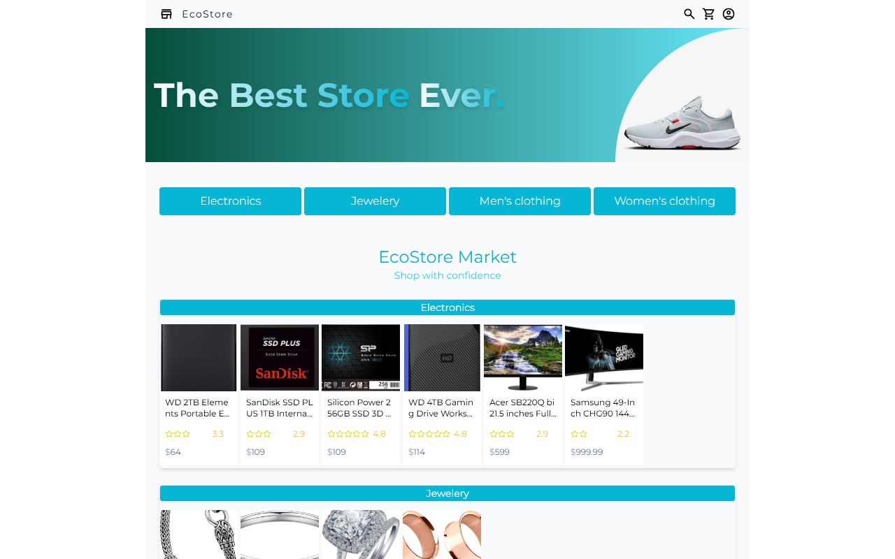

# Ecostore

A practice online store, built to learn React, React Router and fetching data from an API. The products come from the [Fake Store API](https://fakestoreapi.com).

**[Try it live](https://ecostore-dalman.vercel.app)**



## Features

- Products grouped by category: electronics, jewelry, and men's and women's clothing.
- A search page and a page for each product.
- Loading states while data is being fetched.

## Run locally

```sh
npm install
npm run dev
```

## Built with

React 18, React Router, Tailwind CSS and Vite.
